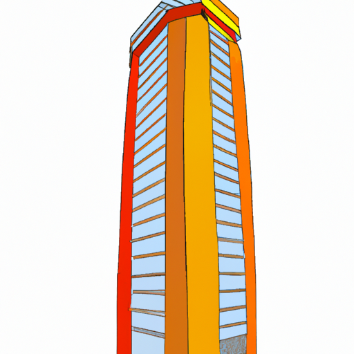

# BevyAI

A 2024 Bevy prototype that tries to generate game art with OpenAI's image API. Hard-coded text prompts become sprites in `assets/`, which are drawn in a Perlin-noise tile world.

> Despite the name, this is a standalone app, not a Bevy plugin or a change to the engine.

## What it does

- **Generates sprites from text prompts** with OpenAI's image API (DALL·E 2 at the time). For example, the character sprite comes from *"Create a single female warrior character with white blackground"*.
- **Removes the background by colour keying.** Each downloaded image has its near-white pixels (R, G and B all ≥ 230) made transparent so it can sit on the map.
- **Builds a world to put them in.** A 500 × 250 grid of 256 px tiles (125,000 sprites) is split into grass and water by Perlin noise, with a new seed on each launch.
- **Lets you walk around.** You move the character with WASD or the arrow keys, and the sprite flips when you move left. The camera follows smoothly, and the mouse wheel zooms (bevy_pancam). Esc quits.



*Early test output for the prompt "A cartoonish style skyscraper". The game doesn't use this file.*

## Running

```sh
cargo run
```

The generated sprites aren't in the repo, so a fresh clone opens an empty window. To see the world, add `grass_transparent.png`, `water_transparent.png` and `character_transparent.png` to `assets/` (tiles are placed 256 px apart).

The generation calls are commented out at the top of `setup` in `src/main.rs`. They used DALL·E 2 through `openai_api_rust` 0.1.9, with the key read from `OPENAI_API_KEY`. OpenAI has since retired DALL·E 2, so they won't work as written.

## Limitations

- The prompts are hard-coded, and the grass prompt actually asks for a witch character.
- API calls block at startup.
- Background removal is brute force and also clears white areas inside a sprite.
- The model it was written for has been retired.

Built May–July 2024 with Bevy 0.13.
